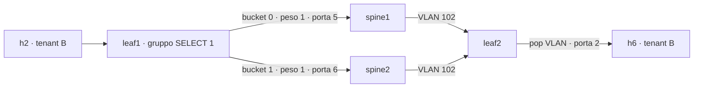

# Forwarding unicast isolato per tenant con ECMP

## Politica e percorso

Il modello fornisce `(DPID, porta) -> (tag, host)` e `(tag, IP) -> host`.
VLAN mancanti/non valide, IPv4 mancanti/non validi e porte assegnate più volte
impediscono l'installazione. Gli IP possono essere uguali tra tenant diversi.
I binding sono statici e caricati all'avvio.

ARP resta untagged in tabella 0: la porta assegnata, il MAC Ethernet, il MAC ARP
e l'IP ARP sorgente devono corrispondere al binding: li verificano le entry OpenFlow.
Il proxy controlla che il frame sia decodificabile come richiesta ARP e risponde
solo a destinazioni del tenant, senza ripetere i controlli sulle sorgenti.
Probe (sorgente 0.0.0.0), gratuitous ARP (sorgente uguale alla destinazione),
reply spontanee e RARP non producono risposte. La reply del proxy
è untagged e viene inviata soltanto alla porta richiedente, senza flooding.

IPv4 dalle porte host richiede porta, MAC e IP sorgente configurati e assenza di
VLAN. Con QoS on la tabella 0 applica prima il meter del tenant, poi il tag
del modello e passa alla 1. Questa ammette
solo la coppia MAC/IP di destinazione configurata nel tenant della VLAN, poi
passa alla 2. La tabella 2 toglie il tag e consegna a un host locale, oppure
inoltra dall'host assegnato dello stesso tenant tramite il gruppo ECMP. Un
pacchetto arrivato dalla fabric può soltanto essere consegnato localmente:
non ha un percorso uplink → uplink.

Ogni leaf ha il proprio gruppo OpenFlow SELECT con ID `1`. Nella configurazione
attuale contiene due bucket con peso `1`: porta 5 verso spine1 (DPID 101) e
porta 6 verso spine2 (DPID 102). Le porte sono ricavate dal modello. SELECT
sceglie un solo bucket per pacchetto; non duplica il traffico. La selezione
predefinita di OVS può mantenere uno stesso flusso sul medesimo percorso: pesi
uguali non impongono una divisione esatta 50/50 su una misura finita.

Entrambi gli uplink ammettono IPv4 con VLAN nota. Entrambi gli spine controllano
VLAN e MAC/IP di destinazione e inoltrano verso il leaf configurato, preservando
il tag e ammettendo soltanto ingressi dagli altri leaf. Il percorso remoto è
host → leaf sorgente → uno degli spine → leaf destinazione → host, senza
flooding, apprendimento dinamico o ritorno sul medesimo link. IPv6 e gli altri
protocolli non hanno regole permissive. La gestione dei guasti degli uplink non
è inclusa: un gruppo SELECT da solo non ne dimostra la tolleranza.



I due rami rappresentano percorsi alternativi. Il modello collega allo stesso
modo tutti e tre i leaf a entrambi gli spine.

| Switch/tabella | Priorità | Match | Istruzioni |
| --- | ---: | --- | --- |
| Leaf/0 | 400 | Porta host, VLAN presente, anche VID 0 | DROP |
| Leaf/0 | 400 | Porta host, EtherType residuo 0x8100/0x88a8/0x9100 | DROP |
| Leaf/0 | 350 | Porta assegnata, ARP untagged, SPA zero oppure TPA uguale all'IP configurato | DROP |
| Leaf/0 | 300 | ARP request untagged, porta e sorgenti Ethernet/ARP del binding | Controller, frame completo |
| Leaf/0 | 200 | IPv4 untagged, porta/MAC/IP sorgenti del binding | METER tenant (QoS on); APPLY push VLAN 0x8100, set VLAN tenant; goto 1 |
| Leaf/0 | 200 | Ciascun uplink, IPv4, VLAN nota | goto 1 |
| Leaf/1 | 300 | ARP | DROP |
| Leaf/1 | 200 | IPv4, VLAN tenant, MAC/IP di una destinazione del tenant | goto 2 |
| Leaf/2 | 200 | VLAN tenant, MAC di destinazione locale | APPLY pop VLAN, output porta host |
| Leaf/2 | 200 | Porta host assegnata nel tenant, VLAN tenant, MAC di destinazione remota | APPLY group 1 (SELECT, output 5 oppure 6) |
| Leaf/0,1,2 | 0 | Table-miss | DROP |
| Spine1,2/0 | 200 | Porta di un leaf diverso dalla destinazione, IPv4, VLAN tenant, MAC/IP di destinazione | APPLY output leaf destinazione |
| Spine1,2/0 | 0 | Table-miss | DROP |

Non ci sono DROP per porta a priorità 100: spare, ingressi sconosciuti e sorgenti
non ammesse ricadono nel table-miss. I tag annidati dalle porte host vengono
bloccati dal tag esterno oppure dall'EtherType residuo.

Cookie per leggere i contatori: `0x47460010` default DROP, `0x47460020` VLAN DROP,
`0x47460021` ARP DROP, `0x47460030` ARP controller, `0x47460040` IPv4 host,
`0x47460041` IPv4 uplink, `0x47460042` destinazione ammessa in tabella 1,
`0x47460050` consegna locale, `0x47460051` uscita tramite gruppo ECMP,
`0x47460052` forwarding di entrambi gli spine.

La funzione di supporto ECMP resta in `src/controller/pipeline.py`, senza un
modulo aggiuntivo. All'avvio e alla riconnessione si rimuovono i vecchi flow,
si ripristinano i default DROP e si elimina/ricrea soltanto il gruppo ECMP del
leaf. Con QoS on si verificano prima le capacità meter e si preparano anche
i meter dei tenant locali. La prima Barrier conferma queste risorse prima dell'installazione
dei flow che richiamano il gruppo. Una seconda Barrier conferma la pipeline
completa e abilita READY del leaf. Gli spine preparano i DROP e i flow senza
creare gruppi e attendono la sola Barrier finale. Errori OpenFlow e timeout
vengono registrati e impediscono
READY; un errore del gruppo non consente di proseguire con i flow dipendenti.
I meter IPv4 di ingresso e la verifica delle capacità sono descritti nella
[guida QoS](qos.md). Non sono introdotti REST o provisioning dinamico.

## Avvio e ispezione manuale

Dalla radice del repository, in due terminali:

```bash
bash scripts/start-controller.sh
bash scripts/start-network.sh
```

Il primo script conserva `PYTHONPATH=src` tramite il percorso assoluto al modulo.
Attendere `ALL SWITCHES READY: 5/5`. Gli script conservano la pulizia precedente
prevista dal progetto. I comandi seguenti sono verifiche manuali di approfondimento.
L'utility `tests/network/packet_io.py` semplifica invio e cattura dei frame,
da affiancare alle verifiche degli sprint precedenti. Non esegue
asserzioni automatiche: i risultati descritti qui vanno verificati manualmente.

Dal terminale Linux (oppure anteporre `sh` dalla CLI Mininet):

```bash
sudo ovs-ofctl -O OpenFlow13 dump-flows leaf1 table=0
sudo ovs-ofctl -O OpenFlow13 dump-flows leaf1 table=1
sudo ovs-ofctl -O OpenFlow13 dump-flows leaf1 table=2
sudo ovs-ofctl -O OpenFlow13 dump-flows spine1
sudo ovs-ofctl -O OpenFlow13 dump-groups leaf1
sudo ovs-ofctl -O OpenFlow13 dump-group-stats leaf1
```

Ripetere per leaf2/leaf3 e spine2. Sono attesi output dati sulle porte host,
sui bucket verso entrambi gli uplink dei leaf e sulle porte leaf di entrambi gli
spine. Ogni leaf ha un gruppo SELECT `1`, con bucket di peso uguale e output 5/6;
gli spine non richiedono gruppi. Non devono esserci NORMAL o FLOOD. Con QoS on,
i soli flow IPv4 host della tabella 0 referenziano i meter del tenant.
ARP esce solo verso il controller.

Per leggere gli stessi contatori in tabelle interattive, avviare da un terminale
Linux `sudo .venv/bin/python tests/network/flow_visualizer.py` e scegliere il
leaf/spine. Premere `b` prima di un test, poi `r` dopo l'invio per vedere gli
incrementi dei flow e dei bucket. Per i bucket sono mostrati peso, porta,
pacchetti/byte prima e dopo, delta e percentuale dei pacchetti del gruppo.
L'ID di una regola apre match e azioni leggibili. Cambiando switch il riferimento
viene ricreato; contatori azzerati o errori di lettura invalidano la relativa
misura. Non si calcolano percentuali senza un riferimento valido o con delta
totale nullo. La modalità `--file` resta limitata ai flow. Le istruzioni
complete sono nel [README](../README.md#visualizzatore-dei-contatori-leafspine).

## Utility per i pacchetti dei test manuali

L'utility richiede Scapy, incluso in `requirements.txt`. Se manca nella `.venv`:

```bash
.venv/bin/python -m pip install 'scapy>=2.6,<3'
```

Dalla CLI Mininet, avviata dalla radice del progetto, eseguire un caso alla volta:

```text
h2 .venv/bin/python tests/network/packet_io.py --iface h2-eth0 --case arp-request
h2 .venv/bin/python tests/network/packet_io.py --iface h2-eth0 --case arp-probe
h2 .venv/bin/python tests/network/packet_io.py --iface h2-eth0 --case gratuitous-arp
h2 .venv/bin/python tests/network/packet_io.py --iface h2-eth0 --case rarp
h2 .venv/bin/python tests/network/packet_io.py --iface h2-eth0 --case ipv4-tagged
h2 .venv/bin/python tests/network/packet_io.py --iface h2-eth0 --case ipv4-untagged
```

Questi casi inviano **un solo frame** e ne mostrano MAC, IP, operazione e VLAN.
Il nuovo caso `ecmp-udp`, descritto più avanti, invia invece più flussi UDP.
Per ARP/RARP l'utility attende un secondo e stampa le eventuali risposte numerate, oppure `Nessuna risposta ricevuta entro 1 secondo.`.
Per IPv4 la consegna si verifica con il listener sul destinatario.
I valori predefiniti sono quelli di h2 verso h6: MAC `00:00:00:00:00:02`, IP
`10.0.0.1`, destinazione `10.0.0.2` / `00:00:00:00:00:06`, VLAN 102.
Per usare altri host o simulare sorgenti diverse, specificare `--mac`, `--ip`,
`--target-ip`, `--target-mac` e, quando serve, `--vlan`.

Da un terminale Linux leggere i contatori **prima e dopo ogni invio**:

```bash
sudo ovs-ofctl -O OpenFlow13 dump-flows leaf1
```

| `--case` | Frame inviato | Contatori e risultato attesi |
| --- | --- | --- |
| `arp-request` | ARP Request normale, SPA `10.0.0.1`, TPA `10.0.0.2` | Reply untagged con MAC di h6 (`00:00:00:00:00:06`) tra le risposte ricevute; incremento della regola ARP-controller, cookie `0x47460030` |
| `arp-probe` | ARP Request, SPA `0.0.0.0`, TPA `10.0.0.2` | DROP tabella 0, priorità 350, cookie `0x47460021` |
| `gratuitous-arp` | ARP Request broadcast, SPA = TPA = `10.0.0.1` | DROP tabella 0, priorità 350, cookie `0x47460021` |
| `rarp` | EtherType `0x8035`, opcode 3 | Table-miss tabella 0, cookie `0x47460010` |
| `ipv4-tagged` | IPv4 valido con VLAN 102 già presente | DROP tabella 0, priorità 400, cookie `0x47460020` |
| `ipv4-untagged` | IPv4 con MAC/IP di h2, senza VLAN, verso h6 | Leaf1: `0x47460040`, `0x47460042`, `0x47460051`; spine scelto: `0x47460052`; leaf2: `0x47460041`, `0x47460042`, `0x47460050`; h6 riceve untagged |

Per i cinque casi successivi ad `arp-request` sono attese zero risposte ARP/RARP.
IPv4 usa il protocollo sperimentale 253 e non richiede una reply: per la consegna
serve il listener sul destinatario descritto sotto, oltre ai contatori.
Il kernel destinatario può comunque inviare un ICMP `Protocol Unreachable`:
in questo caso aumenta anche il flow di ritorno sullo spine. Il listener
filtra il protocollo 253, quindi non mostra gli ICMP, che usano il protocollo 1.
Ogni pacchetto incrementa un solo flow per tabella; due flow opposti possono
incrementare per due pacchetti distinti, quello inviato e quello di ritorno.
Il table-miss di tabella 0
raccoglie traffico locale di sistema; un suo incremento non identifica da solo
il frame inviato. Fermare altri ping durante le misure e usare le catture descritte
più avanti per verificare le porte realmente raggiunte e gli scarti.

RARP non è una normale ARP Reply: quest'ultima usa EtherType `0x0806` e opcode 2.
Per verificare anche il caso positivo del proxy è disponibile `arp-request`:

```text
h2 .venv/bin/python tests/network/packet_io.py --iface h2-eth0 --case arp-request
```

Atteso: una reply untagged con MAC di h6 (`00:00:00:00:00:06`) e incremento
della regola ARP-controller, cookie `0x47460030`. Restano da ripetere i casi dello
sprint precedente nel README e nella sezione sulle regressioni ARP qui sotto.

Per estendere l'utility aggiungere il nome del caso a `CASES` e la costruzione
del frame in `build_packet`. Non occorrono nuovi file o classi di test.

## Consegna IPv4 e isolamento: listener sul destinatario

`--listen` è alternativo a `--case`. Cattura in promiscuità tutti gli IPv4 con
protocollo 253, così mostra anche eventuali consegne con un MAC errato.
Il timeout predefinito è 5 secondi in ascolto e 1 per le reply dell'invio;
`--timeout` permette di allungare la finestra manuale.

Avviare dalla CLI Mininet le catture su h6 (destinazione B) e h5 (tenant A):

```text
h6 .venv/bin/python tests/network/packet_io.py --iface h6-eth0 --listen --timeout 20 > /tmp/good-fences-h6-ipv4.log 2>&1 &
h5 .venv/bin/python tests/network/packet_io.py --iface h5-eth0 --listen --timeout 20 > /tmp/good-fences-h5-ipv4.log 2>&1 &
h6 cat /tmp/good-fences-h6-ipv4.log
h5 cat /tmp/good-fences-h5-ipv4.log
h2 .venv/bin/python tests/network/packet_io.py --iface h2-eth0 --case ipv4-untagged --target-mac 00:00:00:00:00:06
```

Inviare soltanto dopo aver letto `Cattura pronta` in entrambi i log. Al termine
della finestra rileggere i log con gli stessi `cat`: h6 deve mostrare un frame
untagged, sorgente h2 (`...:02`, `10.0.0.1`), destinazione h6 (`...:06`,
`10.0.0.2`); h5 deve riportare zero frame. Leggere anche i contatori del percorso
leaf1 → spine scelto → leaf2. Il frame attraversa uno degli uplink leaf1-eth5
o leaf1-eth6 con VLAN 102; il gruppo sceglie un solo bucket per pacchetto.
Per verificare l'uso di entrambi i percorsi serve la prova ECMP con tuple diverse.

Per ogni attacco avviare una nuova finestra di cattura e salvare un nuovo
riferimento dei contatori prima dell'invio. Con IP sovrapposti specificare
sempre il MAC della vittima: `h1 ping h6` risolve h5 nel tenant A e può riuscire,
quindi non è un attacco verso h6.

```text
h1 .venv/bin/python tests/network/packet_io.py --iface h1-eth0 --case ipv4-untagged --mac 00:00:00:00:00:01 --ip 10.0.0.1 --target-ip 10.0.0.2 --target-mac 00:00:00:00:00:06
h2 .venv/bin/python tests/network/packet_io.py --iface h2-eth0 --case ipv4-untagged --target-ip 10.0.0.2 --target-mac 00:00:00:00:00:05
```

Il primo tenta h1/A → h6/B; il secondo h2/B → h5/A, con lo stesso IP `.2`.
Entrambi superano il binding sorgente in tabella 0, ma terminano nel miss di
tabella 1. Non devono incrementare i cookie di forwarding, né comparire nei
listener di h5/h6. Per gli altri controlli, partire dal comando valido di h2:

| Variazione | Risultato atteso |
| --- | --- |
| `--target-ip 10.0.0.13 --target-mac 00:00:00:00:00:06` | MAC di h6 e IP di h10 incoerenti: miss tabella 1 |
| `--target-ip 10.0.0.99 --target-mac 00:00:00:00:00:06` | IP sconosciuto: miss tabella 1 |
| `--mac 00:00:00:00:00:01 --target-mac 00:00:00:00:00:06` | MAC sorgente falsificato: miss tabella 0 |
| `--ip 10.0.0.99 --target-mac 00:00:00:00:00:06` | IP sorgente falsificato: miss tabella 0 |
| `--case ipv4-tagged --target-mac 00:00:00:00:00:06` | VLAN già presente: DROP tabella 0, cookie `0x47460020` |
| Invio da h4 su `h4-eth0`, con MAC `00:00:00:00:00:04` | Porta spare: miss tabella 0 |

Sono attesi zero frame sui destinatari per tutti i casi negativi. Nessun ping
fallito da solo dimostra isolamento: il caso positivo deve consegnare prima
di confrontare gli scarti.

### Consegna sullo stesso leaf

La configurazione corrente ha un host per tenant su ciascun leaf. Per verificare
anche il percorso locale, fare una copia di `config/tenants.yaml`, sostituire
temporaneamente l'entry h9 del tenant A con:

```yaml
- {name: h4, leaf: leaf1, port: 4, ip: 10.0.0.3}
```

Aggiornare la lista documentale `spare_hosts` togliendo h4 e aggiungendo h9,
poi riavviare controller e rete e attendere tutti gli switch ready. Da h4 avviare
il listener; da h1 inviare `ipv4-untagged` con `--mac 00:00:00:00:00:01`,
`--ip 10.0.0.1`, `--target-ip 10.0.0.3` e `--target-mac 00:00:00:00:00:04`.
Atteso: frame untagged su h4, cookie leaf1 `0x47460040`, `0x47460042`,
`0x47460050`; nessun incremento forwarding uplink/spine. Ripristinare il file
salvato e riavviare prima delle regressioni sulla configurazione originale.

## Classificazione e ingressi: trace manuali

Dal terminale Linux:

```bash
sudo ovs-appctl ofproto/trace leaf1 'in_port=2,dl_src=00:00:00:00:00:02,dl_dst=00:00:00:00:00:06,dl_type=0x0800,nw_src=10.0.0.1,nw_dst=10.0.0.2'
```

Atteso: flow host a priorità 200, push VLAN 102, tabella 1, tabella 2, group 1
e selezione di un bucket verso porta 5 oppure 6. Il trace simula il percorso e
non incrementa i contatori dei pacchetti reali.
Ripetere cambiando un solo campo per volta:

| Variazione del comando | Risultato atteso |
| --- | --- |
| `dl_src=00:00:00:00:00:01` | Table-miss di tabella 0 |
| `nw_src=10.0.0.99` | Table-miss di tabella 0 |
| `in_port=4` | Spare: table-miss di tabella 0 |
| `in_port=LOCAL` | Ingresso non ammesso: table-miss di tabella 0 |
| Aggiungere `dl_vlan=101`, poi 102, poi 0 | DROP tagged a priorità 400 |
| `in_port=5`, aggiungere `dl_vlan=102` | Ammissione uplink, tabella 1, DROP in 2: h6 non è locale, nessun percorso uplink → uplink |
| `in_port=6`, aggiungere `dl_vlan=102` | Stessa ammissione della porta 5, poi DROP in 2: h6 non è locale |
| `in_port=5` oppure `6`, senza VLAN | Table-miss di tabella 0 |
| `in_port=5` oppure `6`, aggiungere `dl_vlan=999` | Table-miss di tabella 0 |

Per la consegna dalla fabric e per il percorso sullo spine:

```bash
sudo ovs-appctl ofproto/trace leaf2 'in_port=5,dl_vlan=102,dl_src=00:00:00:00:00:02,dl_dst=00:00:00:00:00:06,dl_type=0x0800,nw_src=10.0.0.1,nw_dst=10.0.0.2'
sudo ovs-appctl ofproto/trace spine1 'in_port=1,dl_vlan=102,dl_src=00:00:00:00:00:02,dl_dst=00:00:00:00:00:06,dl_type=0x0800,nw_src=10.0.0.1,nw_dst=10.0.0.2'
```

Atteso: leaf2 fa pop VLAN e output 2; spine1 mantiene VLAN 102 e fa output 2.
Sul trace spine1, cambiare `in_port=1` in 2: miss, perché è già il leaf di
destinazione. Anche porta 4, VLAN 101 con MAC della vittima h6 `...:06`, oppure
IP `.13` con MAC h6 producono miss. Lo stesso trace su spine2 deve avere
lo stesso risultato di spine1. Sul trace di leaf2 ripetere `in_port=6`: deve
consegnare ancora a h6 senza VLAN. Questi casi verificano che non si ritorni sul link di ingresso e che MAC/IP
non possano scegliere un host di un altro tenant.

Per ARP dagli uplink:

```bash
sudo ovs-appctl ofproto/trace leaf1 'in_port=5,dl_vlan=102,dl_type=0x0806,arp_op=1,arp_spa=10.0.0.1,arp_tpa=10.0.0.2,arp_sha=00:00:00:00:00:02,arp_tha=00:00:00:00:00:00'
```

Atteso: DROP in tabella 0; nessun output controller. Ripetere con `in_port=6`.

## Pacchetti reali e contatori dalla CLI Mininet

Per IPv4 legittimo, leggere prima e dopo i contatori delle tre tabelle di leaf1:

```text
h2 ip neigh flush dev h2-eth0
h2 ping -n -c 3 -W 1 10.0.0.2
h2 ip neigh show 10.0.0.2
```

ARP risolve il MAC `00:00:00:00:00:06`; i dati incrementano il flow host di porta 2,
la destinazione h6/VLAN 102 in tabella 1 e l'output uplink in tabella 2.
Lo spine selezionato inoltra verso leaf2, che consegna a h6 senza VLAN. Il ping
deve riuscire; un solo ping non deve necessariamente usare entrambi gli spine.

Per inviare un singolo frame esatto senza installare altre librerie, incollare
questo comando nella CLI Mininet. Usa solo Python standard e il socket del namespace h2:

```text
h2 python3 -c "import socket; s=socket.socket(socket.AF_PACKET,socket.SOCK_RAW); s.bind(('h2-eth0',0)); s.send(bytes.fromhex('0000000000060000000000020800450000140000000040fd65eb0a0000010a000002'))"
```

È IPv4 untagged con sorgente valida e protocollo sperimentale 253, senza payload.
Per gli attacchi sostituire soltanto la stringa esadecimale nel comando:

| Caso | Frame esadecimale |
| --- | --- |
| MAC falso | `0000000000060000000000010800450000140000000040fd65eb0a0000010a000002` |
| IP falso (.99), checksum corretto | `0000000000060000000000020800450000140000000040fd65890a0000630a000002` |
| VLAN 101 | `000000000006000000000002810000650800450000140000000040fd65eb0a0000010a000002` |
| VLAN 102 | `000000000006000000000002810000660800450000140000000040fd65eb0a0000010a000002` |
| VID 0 | `000000000006000000000002810000000800450000140000000040fd65eb0a0000010a000002` |
| Doppio tag 101/102 | `00000000000600000000000281000065810000660800450000140000000040fd65eb0a0000010a000002` |

Per i TPID alternativi, sostituire il primo `8100` dei frame tagged con `88a8`
o `9100`. MAC/IP falsi incrementano il table-miss in tabella 0; i tagged un DROP
con cookie `0x47460020`. Il flow host legittimo non deve incrementare.
Per spare, eseguire il comando da h4 cambiando anche il bind in `h4-eth0`:
il frame untagged termina nel table-miss. Ripetere da h8 e h12 sui rispettivi leaf.

## Verifica manuale ECMP

La prova usa OpenFlow 1.3 e il metodo SELECT predefinito della versione OVS
installata. Il caso `ecmp-udp` varia la porta sorgente UDP da `40000` in poi,
con porta destinazione `9000`. `--flows` e `--packets-per-flow` devono essere
positivi; l'intervallo delle porte sorgenti deve rientrare in `1..65535`.
I valori predefiniti sono 100 flussi e 10 pacchetti per flusso, quindi 1.000
pacchetti offerti. IP e MAC sono configurabili come negli altri casi.
L'output riporta gli indirizzi, le porte e i pacchetti effettivamente inviati.

Fermare altri invii durante la misura. Dal terminale Linux annotare la versione
OVS e aprire il visualizzatore su leaf1:

```bash
ovs-vswitchd --version
sudo .venv/bin/python tests/network/flow_visualizer.py --switch leaf1
```

Premere `b` prima dell'invio. Dalla CLI Mininet eseguire:

```text
h2 .venv/bin/python tests/network/packet_io.py --iface h2-eth0 --case ecmp-udp --flows 100 --packets-per-flow 10
```

Premere `r` nel visualizzatore e registrare i contatori del gruppo `1`.
Il criterio è un **delta pacchetti positivo per entrambi i bucket**. La percentuale
osservata del bucket è `100 × delta pacchetti bucket / somma delta pacchetti dei
bucket`: non è richiesta una divisione esatta 50/50. Un singolo ping non è una
prova del bilanciamento.

Ripetere la misura salvando un nuovo riferimento per ciascun leaf: scegliere
`leaf2` per h6 → h10 e `leaf3` per h10 → h2, poi inviare rispettivamente:

```text
h6 .venv/bin/python tests/network/packet_io.py --iface h6-eth0 --case ecmp-udp --mac 00:00:00:00:00:06 --ip 10.0.0.2 --target-mac 00:00:00:00:00:0a --target-ip 10.0.0.13 --flows 100 --packets-per-flow 10
h10 .venv/bin/python tests/network/packet_io.py --iface h10-eth0 --case ecmp-udp --mac 00:00:00:00:00:0a --ip 10.0.0.13 --target-mac 00:00:00:00:00:02 --target-ip 10.0.0.1 --flows 100 --packets-per-flow 10
```

Per ogni misura conservare l'output di invio e compilare una riga per bucket:

| Switch / versione OVS | Traffico offerto e inviato | Bucket / porta | Pkt prima / dopo / delta | Byte prima / dopo / delta | Percentuale pacchetti |
| --- | --- | --- | --- | --- | --- |
| Da rilevare | Tuple, flussi e pacchetti da rilevare | Da rilevare | Da rilevare | Da rilevare | Da calcolare sui delta |

Se i contatori diminuiscono o il gruppo viene reinstallato, ripartire con `b`:
la misura precedente non è valida. In caso di delta nullo su un bucket registrare
il risultato, controllare errori dello switch, regole e configurazione/versione
OVS; il criterio ECMP non è ancora dimostrato. Non sostituire i dati mancanti con
uno split teorico.

`--listen` continua a catturare esclusivamente protocollo IP 253 e non il caso
UDP `ecmp-udp`. I bucket dimostrano la distribuzione; per consegna, isolamento,
overlap, proxy ARP e spoofing ripetere le prove precedenti e quelle seguenti.
Per entrambi i percorsi usare i trace sui due spine e sugli ingressi 5/6 dei
leaf. Nessun test di guasto o failover è incluso in questa verifica.

## Regressioni ARP e catture manuali

Dalla CLI Mininet:

```text
h1 ip neigh flush dev h1-eth0
h1 ping -n -c 1 -W 1 10.0.0.2
h1 ip neigh show 10.0.0.2
h2 ip neigh flush dev h2-eth0
h2 ping -n -c 1 -W 1 10.0.0.2
h2 ip neigh show 10.0.0.2
h1 ping -n -c 1 -W 1 10.0.0.13
h1 ip neigh show 10.0.0.13
```

Atteso: h1 risolve h5 (`...:05`), h2 risolve h6 (`...:06`), h1 non risolve `.13`.
La stessa destinazione IP resta separata per tenant. I primi due ping devono
riuscire; quello verso `.13` dal tenant A fallisce senza risoluzione ARP.

Avviare una cattura temporanea dalla CLI, poi inviare i frame entro 20 secondi:

```text
h2 timeout 20 tcpdump -l -e -n -i h2-eth0 arp > /tmp/good-fences-h2-arp.log 2>&1 &
```

In terminali Linux separati, catturare entrambi gli uplink e una porta host diversa:

```bash
sudo timeout 20 tcpdump -e -n -i leaf1-eth5 arp
sudo timeout 20 tcpdump -e -n -i leaf1-eth6 arp
sudo timeout 20 tcpdump -e -n -i leaf1-eth1 arp
```

Sui link possono esserci protocolli locali: cercare i frame con le identità inviate.
Non devono comparire ARP inoltrati. La cattura h2 deve
mostrare la sola reply untagged del proxy per richieste valide.

Inviare da CLI una richiesta ARP valida con il medesimo comando socket precedente,
sostituendo la stringa con:

```text
ffffffffffff000000000002080600010800060400010000000000020a0000010000000000000a000002
```

Per i casi negativi modificare un solo campo, come indicato qui. I campi del frame
sono `dst Ethernet | src Ethernet | 0806 | 0001 0800 06 04 | opcode | SHA | SPA | THA | TPA`.

| Caso | Modifica alla richiesta valida | Atteso |
| --- | --- | --- |
| Ethernet sorgente falso | Secondo MAC `000000000002` -> `000000000001` | Table-miss 0, nessuna reply |
| SHA falso | MAC dopo opcode -> `000000000001` | Table-miss 0, nessuna reply |
| SPA falso | `0a000001` -> `0a000063` | Table-miss 0, nessuna reply |
| Probe | SPA -> `00000000` | DROP priorità 350 |
| Gratuitous ARP | TPA finale -> `0a000001` | DROP priorità 350 |
| Reply spontanea | Opcode `0001` -> `0002` | Table-miss 0 |
| RARP request | EtherType `0806` -> `8035`, opcode `0001` -> `0003` | Table-miss 0, nessuna reply |
| Tagged | EtherType `0806` -> `810000660806` | DROP priorità 400 |

Per gratuitous reply cambiare insieme opcode e TPA: resta DROP a priorità 350.
Leggere la cattura con `h2 cat /tmp/good-fences-h2-arp.log`. Per i casi negativi
non deve esserci una reply del proxy. Il proxy non esegue una validazione completa
di `hwtype`, `proto`, `hlen` e `plen`: questi casi malformati non fanno parte
dei cinque nuovi test richiesti.

## Riconnessione

Fermare con Ctrl-C soltanto il controller e riavviare `bash scripts/start-controller.sh`.
Lasciare la rete attiva. Attendere nuovamente `ALL SWITCHES READY: 5/5`, controllare
l'assenza di errori OpenFlow e rileggere flow, gruppi e bucket. Ogni leaf deve
avere un solo gruppo ECMP `1` con i due bucket corretti, prima dei flow che lo
referenziano. Ripetere ARP, consegna IPv4, isolamento con MAC della vittima,
spoofing, tagged e la prova ECMP su ciascun leaf.
I contatori ripartono dopo la reinstallazione: salvare nuovi riferimenti con `b`.
Le vecchie eccezioni ARP non devono restare. Registrare separatamente ciò che è
stato osservato: queste procedure
descrivono risultati attesi e non attestano un'esecuzione live dei test.

## Verifiche automatiche ECMP

Il 15 ottobre 2026 sono passati 38 test: 9 sulla pipeline e sul ciclo di
installazione del controller, 22 sul visualizzatore e 7 sull'utility pacchetti.
Le verifiche coprono entrambi i percorsi, le regressioni di isolamento e ARP,
l'ordine gruppi/flow, errori e timeout nelle due fasi, parsing dei bucket e
generazione di tuple UDP diverse. Non è stato aggiunto `test_ecmp.py`.

Per ripeterli:

```bash
PYTHONPATH=src .venv/bin/python -B -m unittest discover -s tests/controller -v
.venv/bin/python -B -m unittest discover -s tests/network -v
```

La distribuzione effettiva su OVS e le regressioni sulla rete restano da
verificare manualmente con la procedura precedente.

## Verifiche storiche dello sprint 1.3

I risultati seguenti si riferiscono alla pipeline precedente, con solo spine1
attivo; non attestano un'esecuzione o il bilanciamento ECMP della versione attuale.

Nello sprint 1.3 passavano i 17 test locali di pipeline e utility. Le prove
usavano il parser Ryu reale e serializzavano le regole per tutti i cinque DPID;
verificavano anche la consegna sullo stesso leaf con due host dello stesso tenant,
usando un modello in memoria.
Il 14 ottobre 2026 è stata eseguita anche una verifica su Mininet/OVS con una
rete temporanea e controller separato. Sono riusciti i ping h1→h5/h9,
h2→h6/h10 e h3→h7/h11; h1→h10 è rimasto senza risoluzione ARP.
Il frame sperimentale h2→h6 è arrivato untagged soltanto a h6.
Le catture su h5/h6 non hanno ricevuto frame negli attacchi h1→h6
(MAC vittima `00:00:00:00:00:06`) e h2→h5 (MAC vittima
`00:00:00:00:00:05`), né con IP/MAC destinazione incoerenti, sorgenti
falsificate, VLAN dalla porta host o invio dalla porta spare.
Allora i trace hanno confermato DROP per uplink→uplink, secondo uplink, ritorno
sullo spine verso il leaf di ingresso e spine2. Oggi secondo uplink e spine2
sono attivi: quei due DROP non sono più risultati attesi. Tutti i cinque switch
erano ready, senza errori OpenFlow; rete e controller temporanei sono stati fermati.
